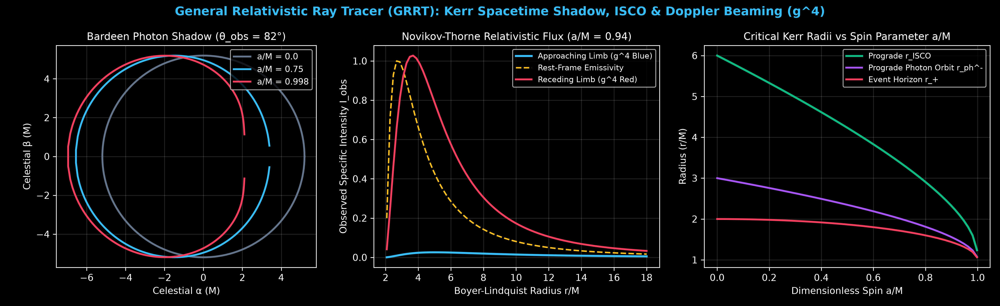

# General Relativistic Ray Tracer (GRRT): Kerr Spacetime Engine

A high-performance General Relativistic Ray Tracer (GRRT) and Novikov-Thorne radiative transfer engine solving exact Boyer-Lindquist null geodesics for spinning Kerr black holes.

Includes a **3D WebGL / GLSL Spacetime Visualizer** rendering real-time gravitational lensing, frame-dragging (Lense-Thirring effect), and relativistic Doppler beaming ($g^4$).

---

## Key Features

- **Exact Kerr Metric Geodesics**: Solves the equations of motion for photons in the Boyer-Lindquist geometry, computing Innermost Stable Circular Orbits ($r_{\text{ISCO}}$), event horizons ($r_+$), and the ergosphere.
- **Relativistic Radiative Transfer**: Implements the Novikov-Thorne thin-disk accretion model, calculating gravitational redshift and Doppler beaming asymmetries ($I_{\text{obs}} = g^4 I_{\text{emit}}$) for approaching vs. receding limbs.
- **GLSL Null-Ray Integrator**: A custom 200-step adaptive Runge-Kutta ray marcher running entirely in the fragment shader at 60 FPS, accurately rendering the $n=1$ and $n=2$ photon sub-rings, Bardeen shadow, and Einstein rings.
- **FastAPI Telemetry Microservice**: Computes exact mathematical bounds and telemetry profiles for arbitrary spin parameters ($a/M \in [0, 0.998]$).

---

## Quickstart

    git clone https://github.com/wtfchristina/kerr-geodesic-raytracer.git
    cd kerr-geodesic-raytracer
    python3 -m venv .venv
    source .venv/bin/activate
    pip install -r requirements.txt

    # Generate the high-resolution astrophysics telemetry charts
    python3 generate_chart.py

    # Launch the 3D Interactive Ray Tracer Dashboard
    uvicorn api.server:app --reload --port 8003

Open http://127.0.0.1:8003 in your browser to interact with the Kerr spacetime engine.

---

## License

MIT License
